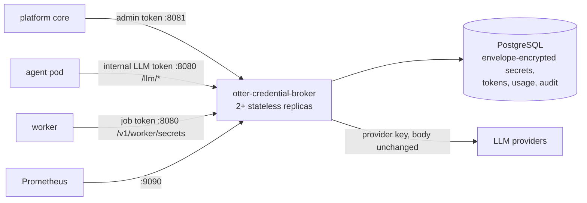

# otter-credential-broker

A small secrets manager with an LLM proxy in front of it, for platforms that
run AI agents on behalf of many tenants.

The broker is the only component that holds provider API keys, SSH keys or
passwords in plain text. Everything else gets secret names or short-lived
tokens:

- Agent pods get an internal LLM token and use the broker as their API base
  URL. The broker swaps the token for the tenant's provider key, forwards the
  request unchanged, streams the response back and charges the usage against
  the token's budget. A leaked token only works through the broker, for one
  tenant, within its budget and rate limit, until it expires or is revoked.
- Workers get a single-use job token that releases exactly the secrets listed
  for one job.
- The platform core manages secrets and tokens through an admin API but can
  never read a stored value back.



## Why

Agents read untrusted content and can be talked into printing their
environment. If the provider key never enters the pod, a prompt injection can
at worst spend a capped budget through a token that is easy to revoke. The
same broker hands workers the credentials of one job, so the platform has one
place that stores, audits and rotates secrets.

## Status

Early; the API may change before a first release. KEKs come from local files;
Vault Transit or a cloud KMS can be added behind the `KeyProvider` trait.

## Quick start

You need the toolchain pinned in `rust-toolchain.toml` and a PostgreSQL
server at the URL in `config/dev.toml`.

```sh
make run-dev   # creates ./secrets (KEK, token key, admin token), listens on localhost:8080/8081/9090

ADMIN="Authorization: Bearer $(awk '{print $2}' secrets/admin-tokens)"

# Store tenant t1's Anthropic key. It is write-only.
curl -s -H "$ADMIN" -H 'content-type: application/json' \
  -d '{"name":"llm.anthropic","kind":"llm_api_key","value":"<your key>"}' \
  localhost:8081/v1/admin/tenants/t1/secrets

# Issue an LLM token for t1: one run, $2 budget, 1 hour. The token is shown once.
curl -s -H "$ADMIN" -H 'content-type: application/json' \
  -d '{"run_id":"run-1","budget_usd":2.0,"ttl_secs":3600}' \
  localhost:8081/v1/admin/tenants/t1/llm-tokens

# Use it like an API key.
curl -s localhost:8080/llm/anthropic/v1/messages \
  -H "x-api-key: ocb_llm_..." -H 'anthropic-version: 2023-06-01' \
  -H 'content-type: application/json' \
  -d '{"model":"model-small","max_tokens":256,"messages":[{"role":"user","content":"Hello"}]}'
```

`model-small` stands for a real model id; with a USD budget the model needs a
price in `[[llm.pricing]]`.

Clients need only a different base URL and key: any configured provider is
reached at `http://<broker>:8080/llm/p/<provider-id>`, whatever its kind;
the older forms `http://<broker>:8080/llm/anthropic` (the provider
`anthropic`) and `http://<broker>:8080/llm/openai/<provider-id>` still work.
The internal token goes where the SDK expects its API key. Several providers
may share a kind, e.g. a public API and a gateway in front of it; a provider
can be limited to some endpoints, to tokens that name it
(`access = "explicit"`), and given its own CA and client certificate
(`tls`). OpenAI-compatible streaming requests must
set `stream_options: {"include_usage": true}`, because the broker never
modifies request bodies and needs the usage chunk for accounting; providers
that always send usage can turn this off with `require_stream_usage = false`.

The full HTTP API is described in [docs/API.md](docs/API.md).

## Configuration

Settings come from defaults, then the TOML file given with `--config` (or
`OCB_CONFIG`), then `OCB_*` environment variables, with nested keys joined by
`__` (`OCB_LLM__MAX_DURATION_SECS=600`). [config/example.toml](config/example.toml)
documents every key. Three key files are required: the KEK (`[kek]`), the
token key (`token_key_file`; changing it invalidates every issued token) and
the admin tokens (`admin_tokens_file`).

Providers and prices apply without a restart: the broker checks the config
file and the providers' TLS files every `reload_interval_secs` and takes
over changes to `[llm.providers.*]` and `[[llm.pricing]]`. An invalid file,
or a change to any other key, is logged and left for a restart. Providers
can only be changed this way; the admin API lists them but cannot edit
them.

The binary has five commands: `serve`, `migrate`, `check-config`, `keygen`
(prints a 32-byte hex key for a KEK or the token key) and `gen-token` (prints
an admin token). Logs are JSON lines on stdout, filtered by `RUST_LOG`. Trace
export uses the standard `OTEL_*` variables and is off by default.

## Security model

- Secrets are envelope-encrypted per record with XChaCha20-Poly1305. Tenant,
  name and kind are bound as associated data, so a row moved or edited in the
  database fails to decrypt. KEKs can be rotated without downtime.
- Every write, every token issue, revocation and redemption, and every
  decrypt is audited. A decrypt does not happen unless its audit row was
  written first.
- Tokens are stored as keyed digests and token rows carry MACs, so write
  access to the database alone cannot mint or widen a token.
- Upstream hosts come only from configuration, never from the API.
  Endpoints, query keys and caller headers are allowlisted, and redirects
  are never followed. A provider with its own TLS settings trusts only its
  own CA.
- A provider can be set to pass more headers by name prefix, never
  credentials, cookies or redirects, and to refuse requests that would have
  it run tools on its own side (web search, web fetch, code execution, MCP
  servers), which would let an agent reach past its network rules.
- Budgets and rate limits are enforced in PostgreSQL, so they hold across
  replicas. Usage comes from the provider's own report even when the caller
  hangs up.
- Keys never appear in logs, traces, metrics or responses, and provider error
  bodies are scrubbed. A test runs every flow with TRACE logging of all
  crates and checks for key fragments.

The [threat model](docs/THREAT_MODEL.md) also lists what is not covered. See
[architecture](docs/ARCHITECTURE.md), [decisions](docs/DECISIONS.md),
[observability](docs/OBSERVABILITY.md) and [SECURITY.md](SECURITY.md) for the
rest.

## Development

```sh
make check   # fmt, clippy -D warnings, tests on a throwaway PostgreSQL
make deny    # cargo deny check
```

Tests need PostgreSQL. Set `OCB_TEST_DATABASE_URL` to a server where the user
may create databases (each test creates and drops its own), or run
`make test-pg`, which starts a temporary cluster and needs `initdb` and
`pg_ctl` on `PATH`. `OCB_SKIP_DB_TESTS=1` skips the database tests.

The code has no `unsafe` and no `unwrap`/`expect` outside tests. New
dependency versions must be at least 14 days old and pass `cargo deny`.

## Deployment

The `Dockerfile` builds a static musl binary on `distroless/static:nonroot`;
pushes to `main` and `v*` tags publish it as
`ghcr.io/iswappp/otter-credential-broker`.
[deploy/k8s/broker.yaml](deploy/k8s/broker.yaml) runs two replicas with a
Service and a NetworkPolicy rule per port;
[deploy/k8s/secret.example.yaml](deploy/k8s/secret.example.yaml) shows the
Secrets it expects.

```
crates/broker-core              secrets, envelope crypto, PostgreSQL store, tokens, usage and pricing
crates/broker-server            HTTP: admin API, worker endpoint, LLM proxy, config, observability
crates/otter-credential-broker  the binary
config/                         example and development configuration
deploy/k8s/                     Kubernetes manifests
docs/                           API, architecture, decisions, threat model, observability
```

## License

Not decided yet; see [LICENSE](LICENSE).
