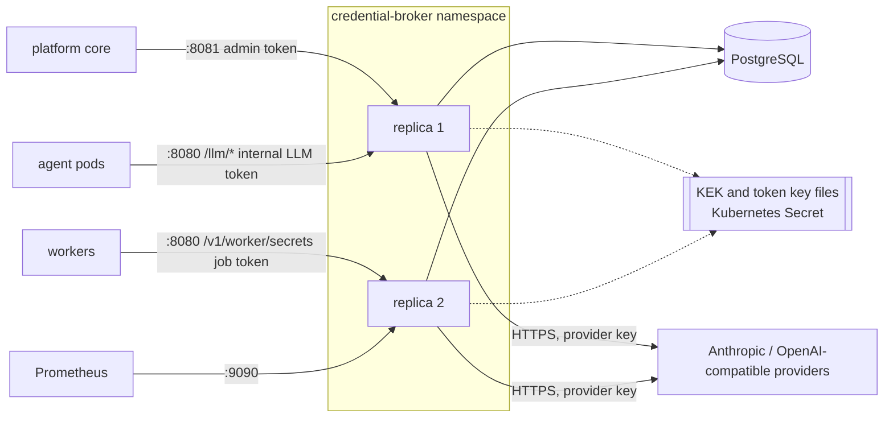

# Architecture

## Components



Secrets, tokens, limits of tenants, rate-limit windows, budgets, usage and
audit live in PostgreSQL, so any replica can serve any request and two or
more run behind a Service. What each replica keeps in memory are limits that
only bound its own load: requests in flight (per token, tenant and provider),
failed token checks per client address and requests to `/llm/_/limits` per
token (see "Limits").

Crates:

- `broker-core`
  - `secret`: `Secret<T>`: no `Debug`/`Display` output, zeroized on drop.
  - `crypto`: envelope encryption, `KeyProvider` trait, `LocalKeyProvider`
    (current KEK plus retired KEKs for unwrapping).
  - `tokens`: token format, keyed digests and row MACs (`TokenHasher`).
  - `store`: PostgreSQL queries (all literal SQL, runtime-checked), migrations.
  - `keeper`: the rules: tenant scoping, write-only values, audit before
    decrypt, token issue/validate/revoke with integrity checks, job
    redemption, KEK re-wrap.
  - `auth`: `Authenticator` trait, static admin tokens. `validate`:
    identifier rules.
  - `llm`: endpoint allowlists, usage extraction (`UsageTap`), price table,
    scrubbing and streaming redaction.
  - `limits`: the levels of limits, their settings and UTC periods.
- `broker-server`: accept loop, routes, admin handlers, worker endpoint, LLM
  proxy and its exchange tasks, limits in memory, the limit headers,
  `/llm/_/limits` and the limit gauges, config validation, the provider
  registry and its reload, TLS of upstream providers, spans and metrics.
- `otter-credential-broker`: the binary and telemetry setup.

## Data model

All timestamps are unix seconds. Every tenant-owned row carries `tenant_id`.

| Table | Content |
|---|---|
| `secrets` | `tenant_id, name, kind, metadata (JSONB), version, kek_id, wrapped_dek, ciphertext`, who/when created and updated. Unique `(tenant_id, name)`. |
| `llm_tokens` | keyed digest of the token, `auth_mac`, tenant, optional run id and label, optional provider allowlist, budgets (`budget_micro_usd`, `budget_tokens`), spend (`spent_micro_usd`, `spent_tokens`, `request_count`), rate limit and its current window, optional run `trace_parent`, `expires_at`, `revoked_at`. |
| `job_tokens` | keyed digest of the token, `auth_mac`, tenant, job id, explicit list of secret names, optional job `trace_parent`, `expires_at`, `used_at`, `revoked_at`. |
| `llm_usage` | one row per proxied request: token, tenant, run id, provider, endpoint, requested model, `response_model` (the model the provider reported), status, input/output/cache tokens, cost, `usage_source` (`reported`, `estimated`, `none`), duration, time to first token, trace id. |
| `audit_log` | `ts, actor, action, tenant_id, secret_name, purpose, trace_id, detail`. Never values. |
| `tenant_limits` | limits of a tenant set through the admin API: `rpm`, `concurrent`, token and micro-USD budgets per day and month; who and when. |
| `limit_rpm` | the current one-minute window (`rl_window`, `rl_count`) of a tenant or a provider with a rate limit. |
| `limit_spend` | spend of a tenant or a provider per UTC period (`period_kind` day or month, `period_start`): `spent_*`, `reserved_*` (held by requests in flight) and the limit in force at the last reservation. |

On the tenant level `provider` is empty, on the global level `tenant_id`.

### Migrations

Migrations live in `crates/broker-core/migrations`; a released one is never
edited, since sqlx checks their checksums. `0001_init` creates every table
above except the last three; `0002_limits` adds those three and a partial
index on the live labelled tokens (for their expiry metric). They run at
start under sqlx's advisory lock (`database.run_migrations`), or with
`otter-credential-broker migrate`.

`0002` only adds. Its index is built inside the migration's transaction,
which holds writes to `llm_tokens` while it is built: on a large table, run
it at a quiet time. A binary older than `0002` refuses to start with
`run_migrations = true` against a database that has it (sqlx reports a
migration it does not know); to go back to one, set
`database.run_migrations = false` for it. It leaves the new tables alone,
and their rows apply again once the newer binary is back.

### Envelope encryption

```
DEK      = 32 random bytes, one per secret version
AAD      = "ocb.secret.v2:" + length-prefixed tenant, name and kind
ct       = nonce(24) || XChaCha20-Poly1305(DEK, value, AAD)
wrapped  = nonce(24) || XChaCha20-Poly1305(KEK[kek_id], DEK, AAD)
row      = (kek_id, wrapped, ct)
```

Binding tenant, name and kind into both layers means a row copied to another
tenant, renamed or re-kinded in the database fails to decrypt instead of
serving the wrong secret (re-kinding an `llm_api_key` would otherwise release
it to a worker). `kek_id` names the KEK that wrapped the DEK, so KEKs rotate
without downtime: make a new KEK current, keep the old one under
`[[kek.previous]]`, call `POST /v1/admin/kek/rewrap` until `remaining` is 0
(only DEKs are re-wrapped; values are not decrypted), then drop the old KEK.

### Tokens

`ocb_llm_<64 hex>` and `ocb_job_<64 hex>`: 32 random bytes with a type
prefix. The broker stores only `HMAC-SHA256(token key, token)`; the plain
token is returned once, at issuance. Each token row also carries `auth_mac`,
an HMAC under the same key over its authorization fields (id, tenant,
provider list or job id and secret list, expiry); a row that fails the check
is refused. So write access to the database without the token key can
neither plant a usable token nor widen an existing one.

Tokens are looked up on every use, with no cache, so a revocation takes
effect on the next request on every replica. A token of one type is rejected
by the other endpoint before any database access. The token key comes from
`token_key_file`; changing it invalidates every issued token.

## Flows

### Secret write (admin)

1. Validate tenant, name, kind, value size, metadata size; values of kind
   `llm_api_key` must be valid HTTP header values.
2. Seal with a fresh DEK (AAD = tenant, name, kind).
3. In one transaction: insert or update the row and write the audit row
   (`secret.create` / `secret.update` / `secret.delete`).

No admin route returns a value.

### LLM request

```mermaid
sequenceDiagram
  participant A as agent pod
  participant H as broker handler
  participant X as exchange task
  participant DB as PostgreSQL
  participant P as provider
  A->>H: POST /llm/p/<provider>/v1/messages (x-api-key: ocb_llm_...)
  H->>H: take the provider snapshot; provider, endpoint and query allowlists, address limiter
  H->>DB: UPDATE llm_tokens ... RETURNING, with the tenant's limits and spend (valid? MAC ok? token window)
  H->>H: in-flight permits: token, tenant, provider, total
  H->>DB: count in the windows of the tenant, then of the provider (one statement)
  H->>H: read body, parse model/stream/max_tokens only
  H->>H: body policy (tools, mcp_servers), token budget pre-check, price lookup
  H->>DB: reserve on the budgets of the tenant and the provider (one transaction, all or nothing)
  H->>DB: audit secret.decrypt, then SELECT sealed llm.<provider> of the token's tenant
  H->>X: spawn with request, key, permit
  X->>P: same body, allowed headers, x-api-key: <tenant key>, traceparent
  P-->>X: status + JSON or SSE
  X-->>H: response head (status, allowed headers)
  H-->>A: head; body chunks follow from the task
  X-->>A: same bytes (tap reads usage, redactor guards the key)
  X->>DB: UPDATE spend + INSERT llm_usage + settle the reservations (after the upstream body ends)
```

- **Routing.** `/llm/p/<id>/<path>` reaches any provider by id;
  `/llm/anthropic/<path>` only the provider with id `anthropic`, and
  `/llm/openai/<id>/<path>` only providers of kind `openai`. `<path>` must
  be an endpoint of the provider's kind that the provider serves
  (`endpoints`), compared on the raw path (no decoding, no normalisation);
  the ids `p` and `limits` are reserved. The upstream URL is
  `base_url + "/" + allowlisted path (+ allowlisted query)`. The provider
  comes from the snapshot the request took when it started (see "Providers
  and configuration reload").
- **Authentication.** The token comes from `x-api-key` or
  `Authorization: Bearer`; several values or two different values are
  refused. Failed checks are counted per client address (see Limits).
- **Validation and rate limit** are one statement:
  `UPDATE llm_tokens SET rl_count = CASE WHEN rl_window = $w THEN rl_count + 1 ELSE 1 END, rl_window = $w WHERE token_hash = $h AND revoked_at IS NULL AND expires_at > $now RETURNING ...`
  (fixed one-minute windows, atomic across replicas), followed by the row
  MAC check and the provider check: a token with a `providers` list may only
  use those, and a provider with `access = "explicit"` only serves tokens
  whose list names it. The same statement reads the limits of the token's
  tenant and its spend; the tenant's and the provider's limits come next
  (see "Limits").
- **Budgets.** The token's: pre-check, refuse when `spent >= budget` (402).
  A token with a USD budget may only use models that have a price (400
  otherwise). Post-accounting: after the upstream response ends, cost and
  tokens are added atomically (saturating). Concurrent requests can each
  pass the pre-check, so a token's budget can be exceeded by the cost of
  its requests in flight at that moment (at most `max_concurrent_per_token`
  per replica). Budgets of the tenant and the provider are reserved before
  the request is sent and settled with its usage (see "Limits").
- **Body policy.** A provider of kind `anthropic` with
  `body.deny_server_tools` refuses, with 400 `server_tool_denied`, a request
  to any of its POST endpoints whose `mcp_servers` is not empty or that has
  a tool with a `type` other than `custom`, unless the type is on its
  `server_tool_allowlist` (exact match). Only `tools` and `mcp_servers` are
  read for this, and a key given twice makes the body unreadable (400), so
  the broker cannot check one value while the provider uses another.
  Nothing is sent upstream for a refused request. Without the policy only
  the fields accounting needs are read.
- **Request.** A fresh request: allowlisted caller headers only
  (`content-type`, `accept`, `anthropic-version`, `anthropic-beta` for
  Anthropic; `content-type`, `accept`, `http-referer`, `x-title` for
  OpenAI-compatible) and those that start with one of the provider's
  `headers.request_forward_prefixes`, provider auth set by the broker
  (marked sensitive), `accept-encoding: identity`, `traceparent`.
  Credentials, cookies, routing (host, forwarding, method override, URL
  rewrite), client address, framing and hop-by-hop headers, and those the
  broker sets, are never taken from the caller (see "Header and body
  policies"). The body bytes are forwarded unchanged. No redirects are
  followed and proxy environment variables are ignored. A provider with
  `tls` is reached through a client of its own; the others share one (see
  "TLS to providers").
- **Exchange task.** The upstream request and its response belong to a task
  of their own, which also does the accounting. The handler waits at most
  `response_timeout_secs` for the response head and then streams what the
  task forwards. The task keeps reading the upstream response to its end
  when the caller hangs up (before or after the head), stops reading (a
  chunk not taken within `idle_timeout_secs`), or the handler stops waiting
  (504). Usage therefore comes from the provider's own report and cannot be
  avoided by hanging up. The cost of this choice: a generation the caller
  abandons runs to completion at the provider and is billed.
- **Response.** Status passed through. Headers: `content-type`,
  `cache-control`, `retry-after`, `request-id`, `x-request-id` and
  `x-should-retry` (the provider telling SDKs whether to retry), and those
  that start with one of the provider's `headers.response_forward_prefixes`
  (never `authorization`, `proxy-authorization`, `x-api-key`,
  `set-cookie`, `www-authenticate`, `location`, `alt-svc`, `ratelimit*`,
  `ocb-*`, framing or hop-by-hop headers), then the broker's own limit
  headers (see "Limits"). A header whose value holds the provider key or
  the caller's token is dropped. Success bodies are streamed chunk by
  chunk; any occurrence of the provider key is replaced by `[REDACTED]` (a
  tail that could be the start of the key is held back until the next
  chunk). Compressed success bodies are refused (502):
  they could be neither redacted nor accounted. Error bodies are read up to
  `max_error_body_bytes` plus the length of the key and the caller's token,
  scrubbed of both and of anything that looks like a credential, and only
  then cut to the limit.
- **Usage.** `UsageTap` parses SSE incrementally (`message_start` /
  `message_delta` for Anthropic, the final chunk's `usage` for
  OpenAI-compatible) or the JSON body, and notes the model the provider
  reports. When no complete report exists, the row is marked `estimated`:
  - the stream ended without a report (e.g. an error event): input from the
    report or request bytes / 4, output from generated characters / 3;
  - no response, a send error after connecting, a stalled or failed stream,
    a compressed body, or a shutdown cut: in addition, output at least the
    request's `max_tokens` / `max_completion_tokens`, since hidden reasoning
    may have been billed;
  - nothing could be sent (connection failed): zero.
- **Cost** = Σ tokens × price per million tokens, in integer micro-USD,
  rounded up, using the price of the model that answered: the requested one
  (or a dated variant of it), another configured model, or, for a model
  without a price, the provider's highest configured price. Anthropic cache
  writes with 1-hour TTL can have their own price. A provider with
  `pricing_from` is priced with that provider's entries; usage rows and
  metrics keep its own id.
- **Timeouts.** Request body read, connect, response head (to the caller;
  the exchange keeps waiting), idle between body chunks, and a total cap
  (`max_duration_secs`) on the upstream exchange.

### Job redemption (worker)

1. `UPDATE job_tokens SET used_at = now WHERE token_hash = $h AND used_at IS NULL AND revoked_at IS NULL AND expires_at > now RETURNING ...`:
   exactly one of any number of concurrent redemptions succeeds. The row MAC
   is checked next; a tampered row is refused.
2. Audit `job_token.redeem`, load the listed secrets of the token's tenant.
3. For each secret: audit `secret.decrypt` (actor `job-token:<id>`, purpose
   `job:<job_id>`, the job's trace id if it was issued with a `traceparent`),
   then decrypt.
4. Return the values with `Cache-Control: no-store`.

Issuance already checks that every name exists in the tenant and that none
is of kind `llm_api_key`; redemption checks both again. A failure after the
token was consumed leaves it consumed (fail closed).

## Providers and configuration reload

Providers and prices are configuration (`[llm.providers.<id>]`,
`[[llm.pricing]]`); the admin API can only list them (D-017). A provider
has an id, a kind (the wire protocol: `anthropic` or `openai`) and a base
URL, and optionally:

| Key | Effect |
|---|---|
| `endpoints` | names of the endpoints it serves, a subset of its kind's; all by default |
| `access` | `implicit` (default): every token of a tenant may use it unless the token's `providers` list leaves it out; `explicit`: only tokens whose list names it |
| `pricing_from` | price its usage with the entries of another provider of the same kind (e.g. a gateway in front of a public API); no chains, and no entries of its own |
| `tls` | `ca_file`, optionally `client_cert` and `client_key`: a client of its own that trusts only that CA and presents that certificate |
| `headers` | `request_forward_prefixes`, `response_forward_prefixes`: more headers passed in each direction, by name prefix; none by default |
| `body` | `deny_server_tools`, `server_tool_allowlist` (kind `anthropic`): refuse requests that would have the provider run tools or contact MCP servers itself; off by default |
| `limits` | `rpm`, `concurrent`, `budget_tokens` and `budget_usd` per `day` and `month`: limits of the provider for every tenant together (see "Limits"); none by default |

Several providers may share a kind; `/llm/p/<id>/...` reaches each of them.

### Snapshot

Validated providers, prices and the HTTP clients of providers with `tls`
form one immutable snapshot. The proxy holds the current one behind a lock
that is only taken to clone or replace an `Arc`. A request takes the
snapshot once, when it starts; its exchange task and its accounting keep
it to the end. A request is therefore routed, sent and priced with the
configuration it started with, whatever a reload does in the meantime.

What has to outlive a reload is not part of the snapshot and is never
replaced: the exchange tasks (shutdown waits for them), the shutdown
switch, the counts of requests in flight per token, tenant and provider and
in total, the failed-token limiter per address, the limiter of
`/llm/_/limits` and the client shared by providers without `tls`. A reload
neither resets limits nor hides a running stream from shutdown; a
provider's `limits` are part of the snapshot and change with it.

### Reload

Every `reload_interval_secs` (default 5, 0 turns it off) the broker reads
the config file and hashes its content. When the hash changed, the file is
loaded and validated again in full, with the same environment overrides:

- it does not load or validate: the running configuration stays (logged,
  counted as `invalid`);
- a key outside `llm.providers` and `llm.pricing` differs: nothing is
  applied; the keys, never their values, are logged (`restart_required`);
- otherwise the new snapshot replaces the current one (`applied`), unless
  it is equal to it (`unchanged`).

A change that is valid but names TLS files that cannot be used yet
(missing, or a new certificate next to the old key) is refused as
`invalid` and looked at again whenever one of those files changes.
ConfigMap and Secret volumes are updated independently, so the files of a
new provider can arrive after the configuration that names them; the
change then applies as a whole once they are in place.

The TLS files of providers are watched the same way, by content. When a
file in use changed (a renewed certificate), the snapshot is rebuilt from
the running configuration. Files that do not fit together, such as a new
certificate next to the old key, are refused until they do. Clients whose
files did not change are carried over, so their connections survive a
reload.

Reading through the path works with Kubernetes volumes: ConfigMap and
Secret updates arrive as an atomic swap of a `..data` link, which the path
follows. A `subPath` mount never receives updates, so mount the directory.
Replicas pick up a change independently, within the kubelet's sync delay
plus `reload_interval_secs`. `ocb_config_version`, the first 48 bits of a
SHA-256 over providers, prices and TLS file contents, shows which
configuration each replica serves; `GET /v1/admin/providers` shows it too.
`ocb_config_reload_pending` is 1 for as long as the files a replica reads
hold a change it does not apply (refused, or waiting for a restart).

### TLS to providers

Providers without `tls` share one client: platform roots, no client
certificate. A provider with `tls` gets a client of its own with the same
redirect, proxy and timeout settings, in which built-in and platform roots
are turned off: only the certificates in `ca_file` are trusted, so neither
a public CA nor another provider's private CA can stand in for this
provider's server, and the client certificate is presented to this
provider only. The earliest expiry of its CA and client certificates is
exported as `ocb_upstream_tls_cert_expiry_timestamp{provider}`.

### Header and body policies

What passes besides the body is closed by default: caller headers on the
allowlist of the provider's kind on the way up, `content-type`,
`cache-control`, `retry-after`, `request-id`, `x-request-id` and
`x-should-retry` on the way back. A provider can open more by name prefix
(`headers.request_forward_prefixes`, `headers.response_forward_prefixes`),
for example a gateway in front of one owner's account that needs every
`anthropic-*` header of the SDK and whose rate-limit headers the caller
may see. Prefixes are lowercase, as header names are compared. Some
headers never pass, whatever the prefixes:

| Direction | Never forwarded |
|---|---|
| caller to provider | `authorization`, `x-api-key`, `proxy-authorization`, `cookie`; `host`, `forwarded`, `x-forwarded-*`, `via`; `x-http-method*`, `x-method-override`, `x-original-method`, `x-original-url`, `x-rewrite-url`; `x-real-ip`, `x-client-ip`, `true-client-ip`, `cf-connecting-ip`; `content-length`, `content-encoding`, `transfer-encoding`; hop-by-hop headers; `accept-encoding`, `traceparent`, `tracestate` (set by the broker) |
| provider to caller | `authorization`, `proxy-authorization`, `x-api-key` (the credentials the broker sends, should an upstream echo them); `content-length`, `content-encoding`, `transfer-encoding`; hop-by-hop headers and `proxy-authenticate`; `set-cookie*`, `www-authenticate`; `ratelimit*`, `ocb-*` (kept for the broker's own limit headers); `location`, `alt-svc` |

A prefix that could match one of them (`x-` matches `x-api-key`, in
either direction; `rate` matches `ratelimit`) makes the configuration
invalid, and every header forwarded by prefix is checked against the list
again.

The body policy (`body.deny_server_tools`, kind `anthropic` only) is
described under "LLM request". It reads `tools` and `mcp_servers` of every
POST body sent to the provider, token counting included, since it takes
the same fields. Allowed tool types are compared exactly, version date
included. A provider of kind `openai` cannot have a body policy:
OpenAI-compatible providers spell their server-side features in their own
ways, so asking for one is refused at load rather than left unchecked.

Both are part of the provider configuration: a reload changes them for new
requests, and `GET /v1/admin/providers` shows them.

## Limits

Limits apply on three levels, and the strictest one decides:

| Level | Requests per minute | Budget | Requests in flight | Set |
|---|---|---|---|---|
| token | the token's row | the token's row, for its whole life | per replica, in memory | when the token is issued |
| tenant | `limit_rpm` | `limit_spend`, per UTC day and month | per replica, in memory | `PUT /v1/admin/tenants/{t}/limits`, audited |
| global (a provider, for every tenant) | `limit_rpm` | `limit_spend`, per UTC day and month | per replica, in memory | `limits` of the provider in the configuration, reloaded with it |

### Order of the checks

A request is checked level by level, and a level only counts a request
that the levels below it let through, so a caller over one level's limit
cannot use up a higher level's for everyone else:

1. The token: found, neither revoked nor expired, its row MAC intact, the
   provider allowed, and its window within its rate limit. One statement
   counts the request in the token's window, as before, and reads the
   tenant's limits and its spend in the current day and month.
2. Requests in flight, in memory: the token's cap, then the tenant's, then
   the provider's, then the replica's total. A request refused here takes
   no slot at any level and is counted in no window above the token's; a
   request refused in step 3 gives its slots back.
3. One statement counts the request in the window of the tenant and then
   of the provider, each with
   `INSERT ... ON CONFLICT DO UPDATE ... WHERE rl_count < limit`: the
   provider's window only takes part when the tenant's let the request
   through, neither counts past its limit, and the result says which level
   refused. The token's own window is in the statement of step 1, because
   the row MAC has to be checked in the broker before anything above the
   token is touched.
4. After the body is read, for billable endpoints: the token's budget as
   before (`spent < budget`), then a reservation on the budgets of the
   tenant and the provider (below).

Windows are fixed one-minute windows keyed by the minute, like the
token's; a replica whose clock is behind counts into the newer window it
finds. A refusal is 429 (rate, requests in flight) or 402 (budget) and
names its level, in the error body and in `ocb-limit-level`.

### Budgets per period

Budgets of a tenant and a provider are per UTC day and month. Each period
is a row of `limit_spend` keyed by the start of the period, so a new period
is a new row and nothing has to reset counters. A billable request reserves
on each of them, in one transaction, all or nothing:
`min(max_tokens, llm.max_reservation_tokens)` tokens (the cap itself when
the request sets neither `max_tokens` nor `max_completion_tokens`), and
their cost at the model's output price. A row takes the reservation while
what it has spent and reserved is below its limit, so requests in flight
cannot each pass a check of what is spent and go over together.

The request carries the start of the periods it was authorized in. Its
exchange settles the reservations with the actual usage in the transaction
that writes the usage row, in those periods: a stream that runs past
midnight counts in the day it started. A request that ends before it
reaches the provider (no key for it, the caller gone) gives its
reservations back. A reservation stays until its period ends only if the
process dies between the two, or accounting fails after its retries.

A USD budget needs prices: a provider with a USD budget must have prices
(checked when the configuration is loaded), a tenant's is refused while the
tenant holds a key for a configured provider without prices (checked at
`PUT`), and while a USD budget applies, a request for a model without a
price is refused (400). A budget counts the requests authorized while it is
set; one set during a period does not count that period's earlier usage.

Rows of `limit_spend` are locked in one order wherever they change, a
tenant's before a provider's and then by key, so transactions never wait on
each other in a cycle. A provider's rows, which every billable request to it
touches, are taken last and held until the commit only. On a laptop with a
local PostgreSQL (no fsync), the full sequence of a billable request
reached about 2000 requests per second through one provider with day and
month budgets and a rate limit, at 64 concurrent workers, against about
6000 with limits on tenants only: well above the request rates of LLM
traffic. If it ever is not, the provider's rows can be split into slots
that are summed when read.

### What callers see

- Every answer to a request whose token was accepted carries
  `RateLimit-Policy` and `RateLimit` for the requests per minute of the
  token and of its tenant, `ocb-budget-*` for the budget of the token or
  tenant nearest to running out, and `ocb-limit-level`. The broker sets
  them last; no header of these names from a provider is ever passed on
  (see "Header and body policies").
- A provider's numbers are never shown to callers, since they come from
  every tenant's requests: its refusals say when the budget renews, and
  `/llm/_/limits` says only `ok`, `near` or `exhausted`, and when that
  changes. The exact numbers are in the admin API and in the metrics.
- `GET /llm/_/limits` checks the token with a read and its MAC, counts no
  request, and has a limit of its own per token and replica.
- `ocb_limit_quota`, `ocb_limit_remaining` and
  `ocb_llm_token_expiry_timestamp` are read from the database every 30
  seconds on each replica (OBSERVABILITY.md).

### Per replica, in memory

| Limit | Setting | Effect |
|---|---|---|
| Requests in flight per LLM token | `llm.max_concurrent_per_token` | 429 `too_many_in_flight`, level `token`, `Retry-After: 1` |
| Requests in flight per tenant | `concurrent` of the tenant | same, level `tenant` |
| Requests in flight per provider | `concurrent` of the provider | same, level `global` |
| Requests in flight in total | `llm.max_concurrent_total` | same, level `global` |
| Requests to `/llm/_/limits` per token and minute | `llm.limits_endpoint_per_minute` | 429 |
| Failed token checks per client address and minute | `http.auth_failures_per_minute` | 429 without a database lookup (proxy, `/llm/_/limits` and worker endpoint) |
| Open connections per listener | `http.max_connections` | further clients wait in the listen backlog |
| Time to receive complete request headers | `http.header_read_timeout_secs` | connection closed |

Caps on requests in flight multiply with the replicas: with N replicas a
tenant can have N × `concurrent` requests in flight. The counts belong to
the process and are never replaced by a reload; the caps come with each
request.

## Trace context

- Admin listener: an incoming `traceparent` is the parent of the request span
  (the platform core is trusted).
- Public listener: callers are untrusted. By default their `traceparent` is
  only recorded as a span link and in the `caller_trace_id` field; spans,
  audit rows and usage rows use the broker's own trace id
  (`http.trust_caller_trace_context` changes this).
- Tokens carry the trusted context: an LLM token issued with `traceparent`
  parents every `llm.request` made with it; a job token issued with
  `traceparent` records its redemption in that trace.
- Outgoing: the upstream request carries a `traceparent` for `llm.request`.

## Deployment shape

- Two or more replicas, rolling updates, a PodDisruptionBudget. Migrations
  run at startup (sqlx takes an advisory lock) or separately with
  `otter-credential-broker migrate` and `run_migrations = false`.
- Three ports: 8080 (agent pods and workers), 8081 (platform core), 9090
  (monitoring), each with its own Service and NetworkPolicy rule. Egress:
  DNS, PostgreSQL and HTTPS to public addresses.
- KEK, token key, admin tokens and the database URL come from mounted
  Secrets. Root filesystem read-only, non-root, all capabilities dropped, no
  ServiceAccount token.
- The config file comes from a ConfigMap, and the TLS files of providers
  from Secrets, mounted as directories (no `subPath`), so changes to
  providers, prices and certificates apply without a restart.
- Shutdown: stop accepting; in-flight requests (streams included) get
  `http.shutdown_grace_secs`; what is left is cut, its usage estimated and
  written; then the process exits. `terminationGracePeriodSeconds` must
  exceed the grace period.
