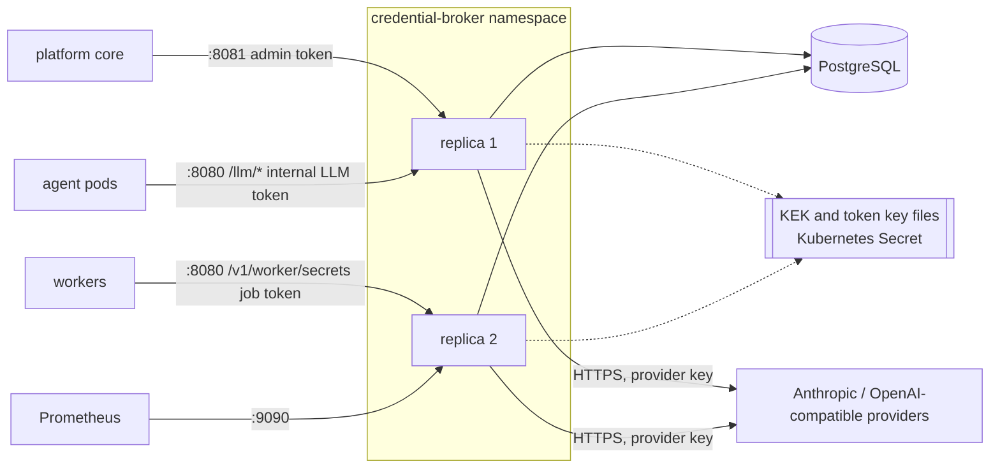

# Architecture

## Components



Secrets, tokens, rate-limit windows, budgets, usage and audit live in
PostgreSQL, so any replica can serve any request and two or more run behind a
Service. What each replica keeps in memory are limits that only bound its own
load: requests in flight and failed token checks per client address (see
"Limits").

Crates:

- `broker-core`
  - `secret`: `Secret<T>`: no `Debug`/`Display` output, zeroized on drop.
  - `crypto`: envelope encryption, `KeyProvider` trait, `LocalKeyProvider`
    (current KEK plus retired KEKs for unwrapping).
  - `tokens`: token format, keyed digests and row MACs (`TokenHasher`).
  - `store`: PostgreSQL queries (all literal SQL, runtime-checked), migrations.
  - `keeper`: the rules: tenant scoping, write-only values, audit before
    decrypt, token issue/validate/revoke with integrity checks, job
    redemption, KEK re-wrap.
  - `auth`: `Authenticator` trait, static admin tokens. `validate`:
    identifier rules.
  - `llm`: endpoint allowlists, usage extraction (`UsageTap`), price table,
    scrubbing and streaming redaction.
- `broker-server`: accept loop, routes, admin handlers, worker endpoint, LLM
  proxy and its exchange tasks, limits, config validation, spans and metrics.
- `otter-credential-broker`: the binary and telemetry setup.

## Data model

All timestamps are unix seconds. Every tenant-owned row carries `tenant_id`.

| Table | Content |
|---|---|
| `secrets` | `tenant_id, name, kind, metadata (JSONB), version, kek_id, wrapped_dek, ciphertext`, who/when created and updated. Unique `(tenant_id, name)`. |
| `llm_tokens` | keyed digest of the token, `auth_mac`, tenant, optional run id and label, optional provider allowlist, budgets (`budget_micro_usd`, `budget_tokens`), spend (`spent_micro_usd`, `spent_tokens`, `request_count`), rate limit and its current window, optional run `trace_parent`, `expires_at`, `revoked_at`. |
| `job_tokens` | keyed digest of the token, `auth_mac`, tenant, job id, explicit list of secret names, optional job `trace_parent`, `expires_at`, `used_at`, `revoked_at`. |
| `llm_usage` | one row per proxied request: token, tenant, run id, provider, endpoint, requested model, `response_model` (the model the provider reported), status, input/output/cache tokens, cost, `usage_source` (`reported`, `estimated`, `none`), duration, time to first token, trace id. |
| `audit_log` | `ts, actor, action, tenant_id, secret_name, purpose, trace_id, detail`. Never values. |

### Envelope encryption

```
DEK      = 32 random bytes, one per secret version
AAD      = "ocb.secret.v2:" + length-prefixed tenant, name and kind
ct       = nonce(24) || XChaCha20-Poly1305(DEK, value, AAD)
wrapped  = nonce(24) || XChaCha20-Poly1305(KEK[kek_id], DEK, AAD)
row      = (kek_id, wrapped, ct)
```

Binding tenant, name and kind into both layers means a row copied to another
tenant, renamed or re-kinded in the database fails to decrypt instead of
serving the wrong secret (re-kinding an `llm_api_key` would otherwise release
it to a worker). `kek_id` names the KEK that wrapped the DEK, so KEKs rotate
without downtime: make a new KEK current, keep the old one under
`[[kek.previous]]`, call `POST /v1/admin/kek/rewrap` until `remaining` is 0
(only DEKs are re-wrapped; values are not decrypted), then drop the old KEK.

### Tokens

`ocb_llm_<64 hex>` and `ocb_job_<64 hex>`: 32 random bytes with a type
prefix. The broker stores only `HMAC-SHA256(token key, token)`; the plain
token is returned once, at issuance. Each token row also carries `auth_mac`,
an HMAC under the same key over its authorization fields (id, tenant,
provider list or job id and secret list, expiry); a row that fails the check
is refused. So write access to the database without the token key can
neither plant a usable token nor widen an existing one.

Tokens are looked up on every use, with no cache, so a revocation takes
effect on the next request on every replica. A token of one type is rejected
by the other endpoint before any database access. The token key comes from
`token_key_file`; changing it invalidates every issued token.

## Flows

### Secret write (admin)

1. Validate tenant, name, kind, value size, metadata size; values of kind
   `llm_api_key` must be valid HTTP header values.
2. Seal with a fresh DEK (AAD = tenant, name, kind).
3. In one transaction: insert or update the row and write the audit row
   (`secret.create` / `secret.update` / `secret.delete`).

No admin route returns a value.

### LLM request

```mermaid
sequenceDiagram
  participant A as agent pod
  participant H as broker handler
  participant X as exchange task
  participant DB as PostgreSQL
  participant P as provider
  A->>H: POST /llm/anthropic/v1/messages (x-api-key: ocb_llm_...)
  H->>H: provider and endpoint allowlist, query keys, address limiter
  H->>DB: UPDATE llm_tokens ... RETURNING (valid? MAC ok? count rate-limit window)
  H->>H: in-flight permit, read body, parse model/stream/max_tokens only
  H->>H: budget pre-check, price lookup
  H->>DB: audit secret.decrypt, then SELECT sealed llm.anthropic of the token's tenant
  H->>X: spawn with request, key, permit
  X->>P: same body, allowlisted headers, x-api-key: <tenant key>, traceparent
  P-->>X: status + JSON or SSE
  X-->>H: response head (status, allowlisted headers)
  H-->>A: head; body chunks follow from the task
  X-->>A: same bytes (tap reads usage, redactor guards the key)
  X->>DB: UPDATE spend + INSERT llm_usage (after the upstream body ends)
```

- **Routing.** `/llm/anthropic/<path>` uses the provider with id `anthropic`;
  `/llm/openai/<id>/<path>` an OpenAI-compatible provider. `<path>` must be
  in the endpoint allowlist of the provider kind, compared on the raw path
  (no decoding, no normalisation). The upstream URL is
  `base_url + "/" + allowlisted path (+ allowlisted query)`.
- **Authentication.** The token comes from `x-api-key` or
  `Authorization: Bearer`; several values or two different values are
  refused. Failed checks are counted per client address (see Limits).
- **Validation and rate limit** are one statement:
  `UPDATE llm_tokens SET rl_count = CASE WHEN rl_window = $w THEN rl_count + 1 ELSE 1 END, rl_window = $w WHERE token_hash = $h AND revoked_at IS NULL AND expires_at > $now RETURNING ...`
  (fixed one-minute windows, atomic across replicas), followed by the row
  MAC check.
- **Budgets.** Pre-check: refuse when `spent >= budget` (402). A token with a
  USD budget may only use models that have a price (400 otherwise).
  Post-accounting: after the upstream response ends, cost and tokens are
  added atomically (saturating). Concurrent requests can each pass the
  pre-check, so a budget can be exceeded by the cost of the requests in
  flight at that moment (at most `max_concurrent_per_token` per replica).
- **Request.** A fresh request: allowlisted caller headers only
  (`content-type`, `accept`, `anthropic-version`, `anthropic-beta` for
  Anthropic; `content-type`, `accept`, `http-referer`, `x-title` for
  OpenAI-compatible), provider auth set by the broker (marked sensitive),
  `accept-encoding: identity`, `traceparent`. The body bytes are forwarded
  unchanged. No redirects are followed and proxy environment variables are
  ignored.
- **Exchange task.** The upstream request and its response belong to a task
  of their own, which also does the accounting. The handler waits at most
  `response_timeout_secs` for the response head and then streams what the
  task forwards. The task keeps reading the upstream response to its end
  when the caller hangs up (before or after the head), stops reading (a
  chunk not taken within `idle_timeout_secs`), or the handler stops waiting
  (504). Usage therefore comes from the provider's own report and cannot be
  avoided by hanging up. The cost of this choice: a generation the caller
  abandons runs to completion at the provider and is billed.
- **Response.** Status passed through. Headers: `content-type`,
  `cache-control`, `retry-after`, `request-id`, `x-request-id`. Success
  bodies are streamed chunk by chunk; any occurrence of the provider key is
  replaced by `[REDACTED]` (a tail that could be the start of the key is held
  back until the next chunk). Compressed success bodies are refused (502):
  they could be neither redacted nor accounted. Error bodies are read up to
  `max_error_body_bytes` plus the length of the key and the caller's token,
  scrubbed of both and of anything that looks like a credential, and only
  then cut to the limit.
- **Usage.** `UsageTap` parses SSE incrementally (`message_start` /
  `message_delta` for Anthropic, the final chunk's `usage` for
  OpenAI-compatible) or the JSON body, and notes the model the provider
  reports. When no complete report exists, the row is marked `estimated`:
  - the stream ended without a report (e.g. an error event): input from the
    report or request bytes / 4, output from generated characters / 3;
  - no response, a send error after connecting, a stalled or failed stream,
    a compressed body, or a shutdown cut: in addition, output at least the
    request's `max_tokens` / `max_completion_tokens`, since hidden reasoning
    may have been billed;
  - nothing could be sent (connection failed): zero.
- **Cost** = Σ tokens × price per million tokens, in integer micro-USD,
  rounded up, using the price of the model that answered: the requested one
  (or a dated variant of it), another configured model, or, for a model
  without a price, the provider's highest configured price. Anthropic cache
  writes with 1-hour TTL can have their own price.
- **Timeouts.** Request body read, connect, response head (to the caller;
  the exchange keeps waiting), idle between body chunks, and a total cap
  (`max_duration_secs`) on the upstream exchange.

### Job redemption (worker)

1. `UPDATE job_tokens SET used_at = now WHERE token_hash = $h AND used_at IS NULL AND revoked_at IS NULL AND expires_at > now RETURNING ...`:
   exactly one of any number of concurrent redemptions succeeds. The row MAC
   is checked next; a tampered row is refused.
2. Audit `job_token.redeem`, load the listed secrets of the token's tenant.
3. For each secret: audit `secret.decrypt` (actor `job-token:<id>`, purpose
   `job:<job_id>`, the job's trace id if it was issued with a `traceparent`),
   then decrypt.
4. Return the values with `Cache-Control: no-store`.

Issuance already checks that every name exists in the tenant and that none
is of kind `llm_api_key`; redemption checks both again. A failure after the
token was consumed leaves it consumed (fail closed).

## Limits

Per replica, in memory:

| Limit | Setting | Effect |
|---|---|---|
| Requests in flight per LLM token | `llm.max_concurrent_per_token` | 429 `too_many_in_flight`, `Retry-After: 1` |
| Requests in flight in total | `llm.max_concurrent_total` | same |
| Failed token checks per client address and minute | `http.auth_failures_per_minute` | 429 without a database lookup (proxy and worker endpoint) |
| Open connections per listener | `http.max_connections` | further clients wait in the listen backlog |
| Time to receive complete request headers | `http.header_read_timeout_secs` | connection closed |

The per-token rate limit and the budgets, which must hold across replicas,
are enforced in PostgreSQL.

## Trace context

- Admin listener: an incoming `traceparent` is the parent of the request span
  (the platform core is trusted).
- Public listener: callers are untrusted. By default their `traceparent` is
  only recorded as a span link and in the `caller_trace_id` field; spans,
  audit rows and usage rows use the broker's own trace id
  (`http.trust_caller_trace_context` changes this).
- Tokens carry the trusted context: an LLM token issued with `traceparent`
  parents every `llm.request` made with it; a job token issued with
  `traceparent` records its redemption in that trace.
- Outgoing: the upstream request carries a `traceparent` for `llm.request`.

## Deployment shape

- Two or more replicas, rolling updates, a PodDisruptionBudget. Migrations
  run at startup (sqlx takes an advisory lock) or separately with
  `otter-credential-broker migrate` and `run_migrations = false`.
- Three ports: 8080 (agent pods and workers), 8081 (platform core), 9090
  (monitoring), each with its own Service and NetworkPolicy rule. Egress:
  DNS, PostgreSQL and HTTPS to public addresses.
- KEK, token key, admin tokens and the database URL come from mounted
  Secrets. Root filesystem read-only, non-root, all capabilities dropped, no
  ServiceAccount token.
- Shutdown: stop accepting; in-flight requests (streams included) get
  `http.shutdown_grace_secs`; what is left is cut, its usage estimated and
  written; then the process exits. `terminationGracePeriodSeconds` must
  exceed the grace period.
